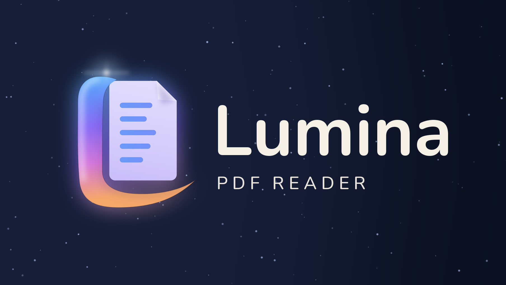
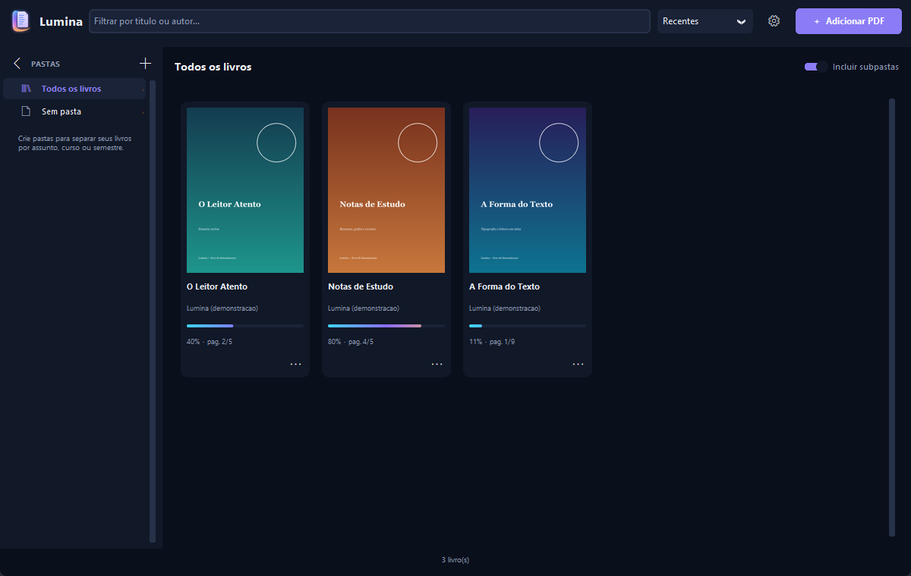
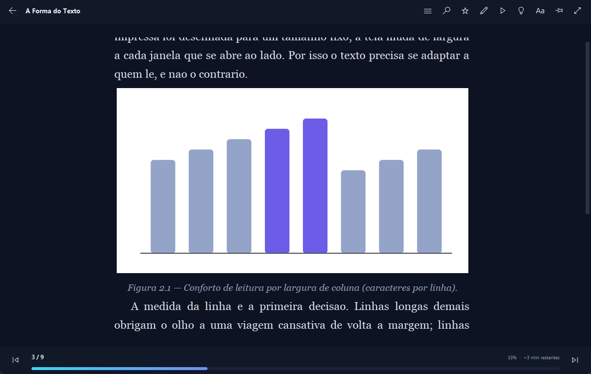
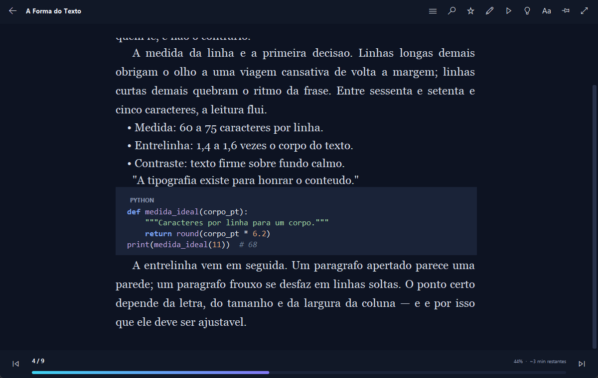
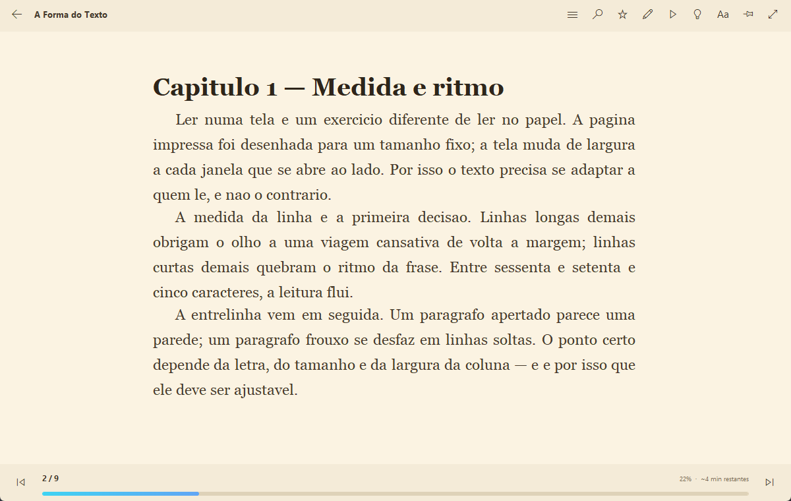
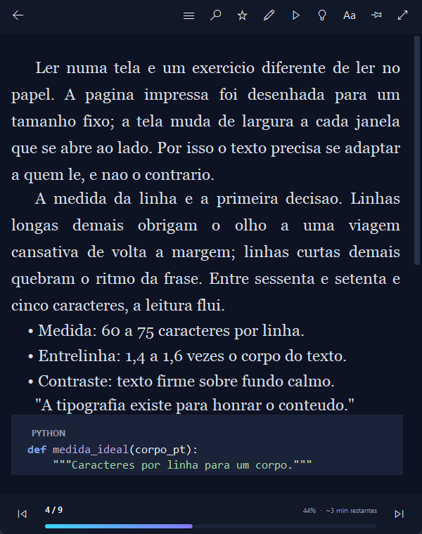

<div align="center">



Transforma PDF em um livro de verdade para ler em tela dividida.

[](https://github.com/DEMTRIOBS/Lumina/actions/workflows/ci.yml)
[](https://github.com/DEMTRIOBS/Lumina/releases/latest)


<br>

</div>

Não é um visualizador de PDF. O Lumina desmonta a diagramação rígida da página
e remonta o texto como um livro: parágrafos reconstruídos, hifenização
desfeita, cabeçalho e rodapé removidos, **texto justificado** e tipografia sob
seu controle — numa coluna que se ajusta a meia tela, ao lado do editor, do
navegador ou da aula.

## Destaques

- **Reflow de verdade** — junta as linhas que o PDF entrega soltas (Word,
  geradores web, EPUB), desfaz hifenização, remove cabeçalho, rodapé e marca
  d'água, e reconhece títulos, listas, citações, legendas e código.
- **Texto justificado** nas duas margens, com a última linha do parágrafo à
  esquerda, como num livro — e recalculado a cada largura de janela.
- **Figuras no lugar certo**, inclusive diagramas vetoriais; um clique abre em
  tamanho real.
- **Código como num editor** — 14 linguagens com realce, numeração do PDF
  removida, copiar/recolher por bloco.
- **Feito para tela dividida** — encaixe em meia tela, modo coluna, sempre
  visível, opacidade, tudo por teclado.
- **Estudo** — grifos, notas, marcadores, busca no livro inteiro, histórico de
  saltos (`Alt+←`) e **exportação para Markdown** (`Ctrl+E`).
- **Converse com o livro** — respostas tiradas do próprio texto, com as
  páginas de origem; funciona com IA local (sem chave) ou Claude, OpenAI e
  Gemini.
- **Leitura em voz alta**, temas Escuro, Claro, Sépia, Noturno e Alto
  Contraste, e retomada exatamente na linha em que você parou.

<table>
<tr>
<td></td>
<td></td>
</tr>
<tr>
<td></td>
<td align="center"></td>
</tr>
</table>

## Baixar

Baixe o **`Lumina.exe`** na página de
[Releases](https://github.com/DEMTRIOBS/Lumina/releases/latest) — arquivo
único, roda em Windows 10/11 sem instalar nada. Para abrir um PDF direto no
Lumina, use **Abrir com → Lumina** no Explorador.

## Rodar a partir do código

```powershell
python -m venv venv
venv\Scripts\activate
pip install -r requirements.txt
python main.py
```

### Gerar o executável

```powershell
pip install -r requirements-dev.txt
python build.py
```

Sai em `dist\Lumina.exe` (~40 MB). Para publicar uma versão, crie uma tag
(`git tag v2.1 && git push origin v2.1`): o GitHub compila o executável e o
anexa à página de Releases sozinho.

### Testes

```powershell
python -m unittest discover -s tests -v
```

Os testes geram PDFs mínimos em memória que reproduzem problemas reais de
livros (linhas soltas, fundos brancos atrás do texto, numeração de código,
marca d'água × figuras) e rodam a cada push no GitHub Actions.

---

## Feito para tela dividida

| Atalho | O que faz |
| --- | --- |
| `Ctrl+Shift+←` / `→` | Encaixa em metade exata da tela |
| `Alt+C` | Modo coluna: faixa estreita colada na borda direita, sempre visível |
| `Ctrl+Shift+↑` / `↓` | Maximiza / restaura |
| `Ctrl+T` | Mantém sobre as outras janelas |
| `Ctrl+[` / `Ctrl+]` | Menos / mais opacidade |
| `F11` | Modo foco: só o texto |

A janela lembra tamanho e posição entre sessões. Abaixo de 720 px a interface
se recolhe sozinha: o título sai da barra, os painéis laterais fecham e a
coluna de texto se reajusta.

## Leitura

| Atalho | O que faz |
| --- | --- |
| `→` / `Espaço` | Avança (rola e vira a página no fim dela) |
| `←` / `Shift+Espaço` | Volta |
| Roda do mouse | Rola; no fim da página, vira sozinho |
| `Home` / `End` | Primeira / última página |
| `Ctrl+G` | Ir para uma página pelo número |
| `Alt+←` / `Alt+→` | Volta / refaz o último **salto** (sumário, busca, Ctrl+G, resposta da IA) — como num navegador. Sem histórico, `Alt+←` volta à estante |
| `Ctrl +` / `Ctrl -` | Tamanho da fonte |
| `Ctrl+P` | Tipografia: tema, fonte, tamanho, entrelinhas, largura da coluna |

Ao reabrir um livro, a leitura volta **à mesma linha** em que parou — não só
à mesma página.

A **largura da coluna é medida em caracteres** (padrão 68, a faixa clássica de
legibilidade), não em pixels — então o texto continua confortável tanto em tela
cheia quanto numa faixa de 450 px.

### Figuras no lugar certo

Cada ilustração aparece **no ponto do texto onde ela está na página** — se o
livro traz a figura entre dois parágrafos, é ali que ela fica. Junto vêm três
correções que só se percebem quando faltam:

- figura fatiada em vários pedaços pelo PDF (mapas e capturas de tela quase
  sempre vêm assim) é remontada numa imagem só;
- logotipo e marca d'água, que se repetem página após página no mesmo lugar,
  não entram na leitura;
- **diagrama vetorial** (fluxograma, gráfico, esquema) volta inteiro. Antes o
  desenho era ignorado e só os rótulos internos sobravam, espalhados como
  palavras soltas no meio da prosa.

A legenda encostada na figura ganha estilo próprio, e a altura da imagem é
limitada para ela não empurrar o texto para fora da tela — um clique abre em
tamanho real.

Em PDFs gerados a partir de EPUB, cada palavra de uma linha justificada chega
como um bloco separado. Elas são recompostas antes do reflow; sem isso o
capítulo saía picado em parágrafos de uma palavra.

### Como virar a página (Ctrl+P)

Quatro modos, porque cada jeito de estudar pede um gesto diferente:

| Modo | Como funciona |
| --- | --- |
| **Livre** (padrão) | A roda rola; ao passar do fim da página, vira sozinha |
| **Botões flutuantes** | Setas redondas surgem nas laterais **só ao chegar ao fim** da página. A roda nunca vira sozinha — nada de pular meia página sem querer |
| **Clique na margem** | Clicar na margem esquerda/direita vira. Como a coluna é estreita e centralizada, a margem é área vazia: selecionar texto continua normal |
| **Rolagem automática** | A página rola sozinha e avança no fim. Controle flutuante com ▶/⏸ e velocidade de 1 a 10 (`Ctrl+Espaço`, ou qualquer rolagem manual, pausa) |

Nos modos **Botões** e **Margem**, toda página nova começa do topo — inclusive
voltando. No modo **Livre**, voltar cai no fim da página anterior, para a
leitura seguir contínua.

## Duas camadas: como exibir × sobre o que é

Uma estante genérica mistura romance, cálculo, mangá, apostila e manual. Separar
por **assunto** criaria dezenas de perfis que se leem igual (engenharia e
medicina são o mesmo problema de leitura). Então são dois eixos independentes:

**Camada 1 — Tipo de renderização** (muda o motor de exibição):

| Tipo | O que muda |
| --- | --- |
| **Prosa** | Recuo de parágrafo, entrelinha 1,75, serifada, coluna de 66 |
| **Técnico** | Hierarquia de títulos reforçada, sem serifa, avisos destacados |
| **Programação** | Realce de sintaxe, menções inline, coluna larga |
| **Matemática** | Entrelinha 1,85, fórmulas maiores, **Courier não vira código** |
| **HQ / Mangá** | A página **é** a imagem — sem reflow. `Ctrl+Shift+Q` liga a leitura **quadro a quadro**: um painel por vez ocupando a coluna inteira, e a página só vira depois do último. Os quadros são detectados em segundo plano e listados no painel lateral |
| **Revista** | Mantém a diagramação original (colunas, layout complexo) |
| **Manual** | Passo a passo, destaque para "Atenção:", "Cuidado:", "Importante:" |

**Camada 2 — Categoria** (Computação, Engenharia, Direito, História…): só
organiza a estante — filtro e identificação no cartão. **Não altera a leitura.**

Um livro pode ser `Renderização: Programação` + `Categoria: Computação`, ou
`Renderização: Técnico` + `Categoria: Engenharia`, ou `Renderização: Prosa` +
`Categoria: Literatura`.

Tudo em `Ctrl+P → Este livro`. A detecção é automática e usa só medidas do
arquivo (fração monoespaçada, fontes de fórmula, área de imagem, colunas,
densidade de títulos) — nunca o título, porque "Cálculo I" pode ser uma
apostila digitalizada e "Django" pode não ter uma linha de código em texto.

### Realce de código

14 linguagens — Python, JavaScript, TypeScript, Java, C#, PHP, Ruby, Go, Rust,
SQL, HTML, CSS, JSON, YAML e shell — cada uma com sua sintaxe de comentário
(`#`, `//`, `--`, `<!-- -->`). Trechos curtos (`manage.py runserver`) herdam a
linguagem dominante do livro por votação.

**Copiar e recolher aparecem ao passar o mouse sobre o bloco**, como num
editor, ancorados no canto superior direito dele. Só os do bloco apontado —
sempre visíveis, numa página com cinco trechos eram dez ícones flutuando sobre
o texto. O código sai limpo: sem `>>> `, sem `$ `, sem números de linha.
`Ctrl+Shift+C` copia todos os blocos da página de uma vez.

## Organização em pastas

A estante funciona como um explorador de arquivos: pastas aninhadas sem limite
de profundidade, e cada livro mora em **uma** pasta.

```
📚 Todos os livros
📄 Sem pasta                  ← livros ainda não organizados
📁 Estudo de Python
   📁 Django
   📁 Ciência de Dados
📁 Faculdade
   📁 Cálculo I
   📁 Programação Orientada a Objetos
```

- **Nova pasta** pelo `＋` da barra lateral, ou **Nova subpasta** no menu `⋯`
  de qualquer pasta
- **Mover** livros e pastas pelo menu `⋯` → escolhe o destino na árvore
- **Renomear livro** no menu `⋯`: PDFs sem metadado caem no nome do arquivo,
  que às vezes é só um número
- **Incluir subpastas** (interruptor no topo): abrir *Faculdade* mostra os
  livros de todas as matérias de uma vez
- **Recolher o menu de pastas** pelo `‹` no topo da árvore: a estante ganha a
  largura inteira e a navegação continua pelo seletor de pastas. O `☰` traz a
  árvore de volta
- PDFs adicionados entram na **pasta que está aberta**
- **Excluir uma pasta nunca apaga livros** — eles voltam para "Sem pasta"
- Digitar no filtro busca em **toda a biblioteca**, ignorando a pasta atual, e
  cada resultado mostra em que pasta está

Em janela estreita a árvore vira um seletor suspenso, para não comer a largura
útil da leitura, e os livros passam a ser listados **um embaixo do outro** —
capa pequena à esquerda, título, progresso e ações na mesma linha. Em meia tela
o cartão em pé mostrava um livro de cada vez; deitado, mostra a estante toda.

## Estudo

| Atalho | O que faz |
| --- | --- |
| `Ctrl+F` | Busca no **livro inteiro** · `F3` próximo resultado |
| `Ctrl+B` | Sumário, marcadores e notas |
| `Ctrl+H` | Grifar a seleção |
| `Ctrl+N` | Anotar a página |
| `Ctrl+D` | Marcar a página |
| `Ctrl+I` | Assistente de estudo |
| `Ctrl+L` | Ler a página em voz alta |
| `Ctrl+E` | **Exporta** grifos, anotações e marcadores para Markdown, agrupados por capítulo |

A anotação (`Ctrl+N`) é salva sozinha ao fechar com `Esc` ou no X — só o
botão Cancelar descarta.

Selecionar texto faz surgir uma barra flutuante com grifar, apagar grifo,
copiar, anotar e enviar ao assistente.

---

## Leitura em voz alta

Usa a síntese que já vem no Windows — nada a instalar. Em **⚙ Configurações →
Voz**: escolha da voz, velocidade, tom e **volume até 200%**.

O mecanismo do Windows para em 100% e ainda assim sai baixo, porque a narração
tem sessão própria no mixer. Acima disso o áudio é sintetizado em arquivo,
normalizado pelo pico e amplificado com limitador — sobe bastante sem distorcer.
Esse preparo leva alguns segundos numa página inteira e acontece **em segundo
plano**: a leitura continua rolando enquanto o áudio é preparado.

---

## Conversar com o livro

Pergunte sobre o livro aberto e a resposta sai **do texto dele**, com as
páginas de origem e um botão para saltar até lá.

A regra da arquitetura é: **o Lumina responde, a IA escreve.** Quem decide o
que é verdade é um índice do livro — determinístico e auditável, sem modelo
nenhum. O modelo entra depois, só para redigir o que o índice já encontrou.
Ele nunca pesquisa e nunca preenche lacuna.

Isso existe por uma medição. Perguntado sobre algo fora do material que
recebeu, e mandado explicitamente a dizer "não sei", o modelo de 0,5B levou
50 s para inventar uma classe inexistente e entrou em loop. Dentro do
material, respondeu certo em 12 s. A diferença entre útil e perigoso é
inteiramente ter ou não ter o texto em mãos.

### O Guardião

A busca devolve uma confiança **absoluta** (não relativa ao melhor resultado —
esse era o erro óbvio, que daria nota máxima até quando o livro não fala do
assunto):

| Confiança | O que acontece |
|---|---|
| ≥ 0,70 | o livro cobre — a IA redige, citando as páginas |
| 0,45–0,70 | o livro toca no assunto — mostra os **trechos crus**, sem IA |
| < 0,45 | "Não encontrei essa informação neste livro" — não inventa |

Medido no livro de Django da estante: perguntas cobertas ficaram entre 0,60 e
1,00; perguntas de fora, entre 0,00 e 0,33.

### O Verificador

Depois de o modelo escrever, todo identificador técnico da resposta
(CamelCase, snake_case, ALL_CAPS) é procurado nos trechos de origem. Citou um
nome que não estava lá? A resposta é descartada e os trechos aparecem crus.

### E quando a pergunta não é sobre o livro?

Um roteador decide o destino **sem consultar IA** — regex sobre a pergunta,
instantâneo e previsível (7/7 nos testes):

- `O que é uma ForeignKey?` → **livro**
- `Rodei manage.py migrate e deu OperationalError` → **IA** (conhecimento geral)
- `O livro fala de QuerySet mas meu código deu AttributeError` → **híbrido**,
  com as duas metades separadas e rotuladas

Toda resposta é rotulada com a origem. Você sempre vê se aquilo veio do livro
ou da cabeça do modelo.

### Busca unificada (Ctrl+F)

Não existem mais duas buscas. `Ctrl+F` usa o índice e devolve tudo num painel
só, marcando **como** cada resultado foi achado:

| Marca | Origem |
|---|---|
| (sem marca) | a palavra está escrita ali |
| `~` | mesmo assunto, outras palavras |
| `≈` | conceito relacionado |

Digitar `relacionamento entre tabelas` acha os trechos de `ForeignKey`,
`OneToOneField` e `ManyToManyField` — sem que nenhuma dessas palavras tenha
sido digitada. A expansão vem de uma tabela de co-ocorrência montada na
indexação (não é grafo, não é embedding): conceitos que aparecem juntos num
bloco ficam ligados, e palavras comuns ganham uma ponte para os conceitos com
que convivem. É o que traduz "consulta" em `QuerySet`.

O resultado literal vem sempre primeiro — quem digita uma palavra exata quer
vê-la — mas ordenado por relevância, com o bloco que **define** o termo na
frente do que só o repete.

### Conversa contextual

O assunto se mantém entre perguntas:

```
O que é uma ForeignKey?          → conf 1,00, páginas 43/44/56
E como ele funciona?             → herda "ForeignKey"
Tem exemplo?                     → ainda ForeignKey
E qual a diferença para OneToOne? → ainda ForeignKey, agora com OneToOne
```

Herda o **assunto**, não a pergunta inteira. Acumular a frase toda parecia
óbvio e degradava a busca a cada troca — a confiança caía de 1,00 para 0,55 em
duas perguntas, porque "como", "exemplo" e "funciona" diluem a cobertura. A
resposta mostra o que foi entendido, para você conferir.

### O índice

Blocos de 300–700 caracteres (não páginas: uma página mistura três assuntos),
com página, capítulo, tipo e conceitos. TF-IDF com reranker por cobertura —
sem embeddings, que exigiriam um segundo modelo e minutos de inferência.

Sobe em segundo plano ao abrir o livro, **começando pela página onde você
está**, e fica em cache: 321 páginas → 607 blocos em 2 s, 157 KB em disco. Da
segunda abertura em diante, instantâneo.

---

## Assistente de estudo

Fila com queda automática: **quem você escolher → os demais como reserva →
modo offline**. Se um falhar (sem rede, chave inválida, cota estourada), o
próximo assume — o botão Processar nunca fica sem resposta.

### IA local, sem configurar nada

Não precisa de chave, de cadastro nem de instalar programa separado. O leitor
resolve sozinho, em três degraus:

1. **Já existe um servidor na máquina?** Ollama, LM Studio, Jan e LocalAI são
   procurados nas portas padrão. Achando um, ele usa **o menor modelo que
   aquele servidor tiver** — resumir e listar conceitos não pede raciocínio
   longo, e um modelo pequeno responde em ~1 s onde um de 7B levaria quase um
   minuto em CPU. Zero download.
2. **Não existe?** Um botão em ⚙ Configurações baixa o motor (17 MB) e um
   modelo de 0,5B (380 MB) para `%APPDATA%\Lumina\ia`. Uma vez só. Dali em
   diante funciona offline.
3. **Não quis instalar?** O modo extrativo responde assim mesmo.

O modelo roda em processo separado e **sobe só na primeira pergunta**,
desligando sozinho após dez minutos parado — 600 MB não ficam presos por causa
de um assistente que talvez não seja usado hoje.

Em **⚙ Configurações → Assistente de IA** dá para escolher quem responde
primeiro. Se você tem chave de API mas prefere que nada saia da máquina,
escolha **IA local** e a chave vira só reserva.

O modo offline não usa rede nem chave: faz resumo por frequência de termos,
extrai conceitos com bigramas, monta flashcards a partir de frases de definição
e responde perguntas por busca extrativa.

### Ler o conteúdo da janela ao lado

O nome do programa diz pouco — o navegador serve tanto para um vídeo de cálculo
quanto para um tutorial de Python. Ligando **⚙ → Contexto → "Ler o texto das
janelas ao lado"**, o Lumina lê o texto real daquela janela e acerta o assunto.

Não é OCR e não captura imagem da tela: o texto vem da **árvore de
acessibilidade do Windows**, a mesma que os leitores de tela usam — texto
exato, em milissegundos. Medido: **5 acertos em 6, em 0,6 ms**, contra 2 em 6
adivinhando pelo nome do programa. A classificação é por regras, não por IA —
com o mesmo texto, o modelo de 0,5B acertou 2 e levou 400 ms.

A leitura é feita **quando você troca de janela**, não a cada segundo, e roda
em segundo plano (20–240 ms). O texto lido nunca vai para disco nem para
servidor: vive 45 segundos em memória e é descartado.

Interruptor **separado** do resto do contexto, e desligado de fábrica: aceitar
"veja qual programa está aberto" não é aceitar "leia o que está escrito nele".

### O palpite da IA na detecção de contexto

Quando as regras, o perfil do livro e a sua memória de escolhas **empatam**, o
modelo local dá um palpite. Só aí — nos casos já decididos ele nem é
consultado, porque gastaria 0,2 s para repetir o que uma tabela já sabia.

O palpite se apresenta como palpite: *"code.exe ao lado, mas as pistas se
dividiram. A IA local apostaria em modo Programação — testar?"*. Medido com o
0,5B, esse desempate acerta perto de metade das vezes, e é por isso que ele
nunca vira certeza nem se aplica sozinho.

**Toda aplicação é um teste.** Depois de aceitar, a mesma barra vira
*"aplicado · não gostou?"* com **Desfazer** por 20 segundos — modo, categoria
e cores voltam ao que eram. Desfazer também ensina: aquele modo para de ser
sugerido para aquele programa.

Trocou a janela do lado? Ele sugere de novo, para a nova — inclusive ao voltar
para uma que você já tinha recusado antes.

O modelo consultado é **sempre o local**, nunca a chave de API: isto roda a
cada poucos segundos enquanto você lê, e mandar o título das suas janelas para
um servidor a cada volta seria indefensável.

---

## Seus dados

Tudo em `%APPDATA%\Lumina\`:

- `meu_leitor.db` — biblioteca, progresso, grifos, notas, marcadores
- `capas_cache\` — miniaturas

Abrir um PDF pelo **"Abrir com → Lumina"** do Windows (ou arrastá-lo sobre o
`.exe`) já adiciona o livro à estante e abre na leitura.

Atualizar o `.exe` **não** apaga nada. Livros são identificados pelo conteúdo do
arquivo, então mover ou renomear o PDF preserva progresso e anotações. Se o
arquivo sumir, a estante oferece reapontar o caminho sem perder o histórico —
e avisa se o arquivo escolhido for outra edição, porque os grifos cairiam no
lugar errado.

Bases da versão 1.0 (`biblioteca.json`, `config.json`) são importadas
automaticamente na primeira execução.

---

Arquitetura e decisões de implementação: veja `structure.txt`.
